# Post-contenido — Unidad 7: Patrones Arquitectónicos I

**Estudiante:** Juan Pablo Guerrero Hernandez
**Asignatura:** Patrones de Diseño de Software

## Descripción
Repositorio del post-contenido de la Unidad 7 de Patrones de Diseño de Software. Es un único
proyecto Spring Boot (`multas-biblioteca-api`) para la gestión de multas de la biblioteca: cuando un
estudiante devuelve un libro tarde se registra una multa, se calcula su monto y luego se marca como
pagada. Tiene dos partes:

1. **Parte 1:** API REST en capas (Model, Repository, Service, Controller) sobre H2.
2. **Parte 2:** pago en línea de multas con dos pasarelas intercambiables (PagosUDES y Wompi). Aquí
   se eligió un **puerto de dominio con dos adaptadores (opción C)**, aplicado **solo** a la porción
   de pago; el resto del proyecto sigue en capas.

### Estructura final

```
Guerrero-post1-u7/
├── README.md
├── docs/
│   ├── decision-parte2.md          ← borrador de la decisión, escrito antes del código
│   └── capturas/                   ← evidencia de los endpoints (curl)
├── simulador-pasarelas/
│   └── SimuladorPasarelas.java     ← PagosUDES (9001) y Wompi (9002) falsos, solo JDK
└── multas-biblioteca-api/
    ├── pom.xml
    └── src/main/java/com/example/multas/
        ├── MultasApplication.java
        ├── controller/       Presentación    MultaController, GenerarMultaRequest, GlobalExceptionHandler
        ├── service/          Aplicación      MultaService
        ├── model/            Dominio (P1)    Multa, EstadoMulta, excepciones de negocio
        ├── repository/       Infraestructura MultaRepository
        ├── domain/           ← NUEVO P2: Java puro, sin Spring
        │   ├── port/PasarelaPagoPort.java
        │   ├── SolicitudPago.java
        │   ├── ResultadoPago.java
        │   └── PagoRechazadoException.java
        └── infrastructure/   ← NUEVO P2: sí conoce Spring y HTTP
            ├── pago/PagosUdesAdapter.java
            ├── pago/WompiAdapter.java
            └── config/RestTemplateConfig.java
```

---

## Parte 1 — Arquitectura en Capas

Las dependencias van en un solo sentido:

```
MultaController ──► MultaService ──► MultaRepository ──► H2
       │                 │
       └────────► model/ (Multa y excepciones) ◄────────┘
```

- **controller/** solo traduce HTTP ↔ Java: recibe el JSON, lo valida con `@Valid` y convierte las
  excepciones de negocio en códigos HTTP (`GlobalExceptionHandler`). Nunca toca el repositorio.
- **service/** contiene las decisiones de negocio: el tope de 3 multas pendientes por estudiante y la
  generación de la multa. No sabe nada de HTTP.
- **model/** es la entidad `Multa` con su propio comportamiento (`calcularMonto` y
  `marcarComoPagada`) y las excepciones del dominio.
- **repository/** es la única capa que habla con la base de datos.

### Reglas de negocio y dónde viven

| Regla | Dónde | Por qué ahí |
|---|---|---|
| Monto = días × $500, con tope de $15.000 | `Multa.calcularMonto` (entidad) | No necesita ningún colaborador externo (Punto de decisión 1) |
| Una multa pagada no se puede volver a pagar | `Multa.marcarComoPagada` (entidad) | Es una invariante del estado de la propia multa |
| Máximo 3 multas pendientes por estudiante | `MultaService.generar` | Necesita datos que solo tiene la BD; la decisión la toma el Service y el conteo lo hace `countByEstudianteIdAndEstado` (Punto de decisión 2) |

Así `MultaService` no es un passthrough del repositorio: `generar` decide si se permite la multa
antes de crearla, y `pagarConPasarela` (Parte 2) orquesta la pasarela y el cambio de estado.

### Endpoints

| Método | Ruta | Respuesta |
|---|---|---|
| GET | `/api/multas` | 200 con todas las multas |
| GET | `/api/multas/{id}` | 200, o 404 si no existe |
| GET | `/api/multas/estudiante/{estudianteId}` | 200 con las multas del estudiante |
| POST | `/api/multas` | 201 con la multa creada; 400 si faltan datos; 409 si ya tiene 3 pendientes |
| PATCH | `/api/multas/{id}/pagar` | 200 con la multa PAGADA (VENTANILLA); 409 si ya estaba pagada |
| POST | `/api/multas/{id}/pagar-en-linea` | *(Parte 2)* 200 PAGADA con el proveedor; 402 si la pasarela rechaza; 409 si ya estaba pagada |

### Capturas de los endpoints probados (Parte 1)
Todas las capturas son la salida real de `curl` contra la aplicación corriendo en `localhost:8080`.

**GET /api/multas al inicio — 200 OK con lista vacía**
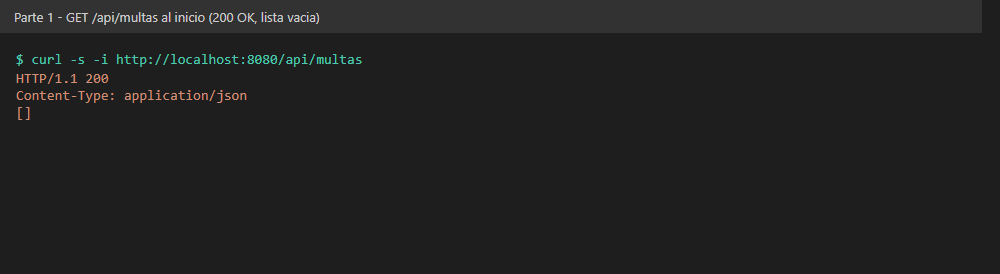

**POST /api/multas — 201 Created.** 4 días → $2.000; 45 días → $15.000 por el tope.
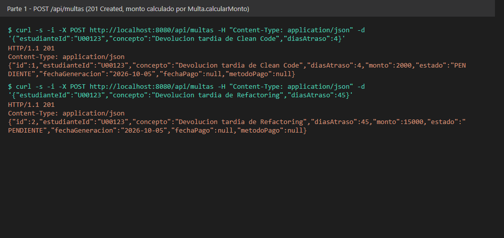

**POST /api/multas sin estudianteId — 400 Bad Request**
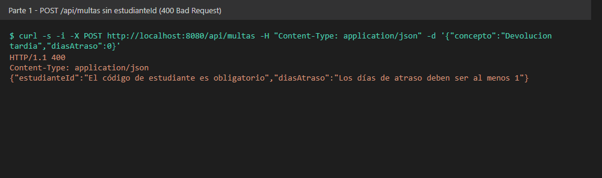

**Cuarta multa pendiente del mismo estudiante — 409 Conflict**
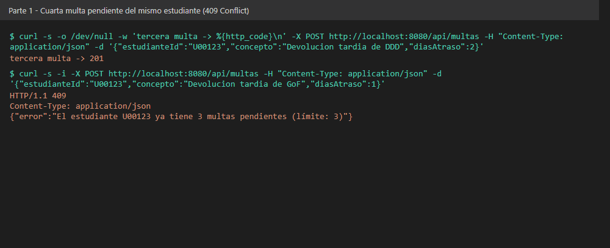

**GET /api/multas/999 — 404 Not Found**
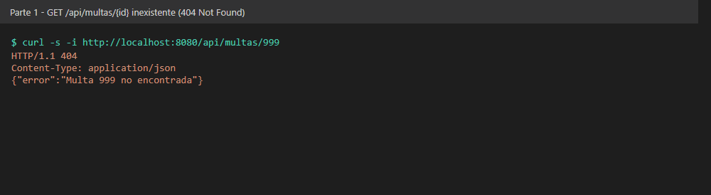

**PATCH /api/multas/1/pagar — 200 OK y al repetirlo 409 Conflict**
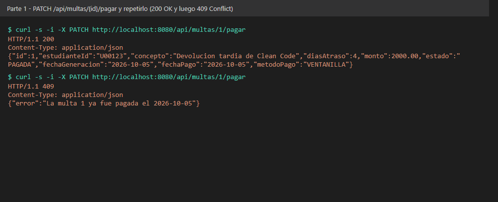

**GET /api/multas/estudiante/U00123**
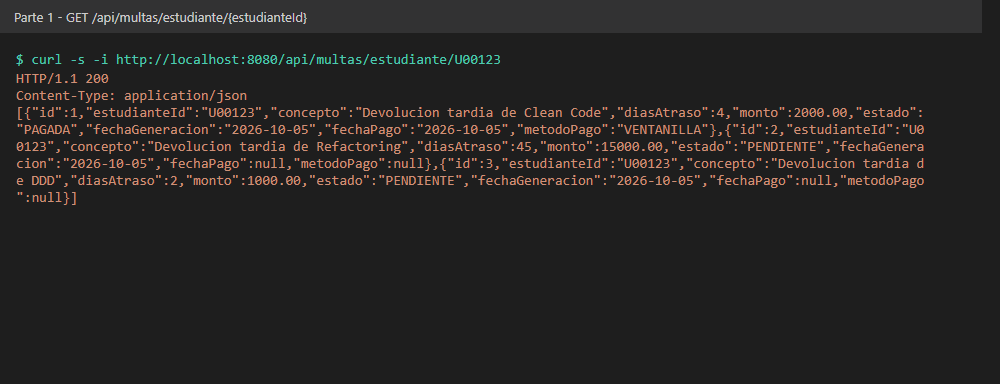

---

## Parte 2 — Pago en Línea con Dos Pasarelas

### Opción elegida: C, puerto de dominio con dos adaptadores (solo en el pago)

```
            MultaController ──► MultaService ──► PasarelaPagoPort  (domain/port, Java puro)
                                     │                  ▲       ▲
                                     │       implements │       │ implements
                                     ▼                  │       │
                          SolicitudPago / ResultadoPago │       │
                          (domain/, Java puro)   PagosUdesAdapter  WompiAdapter   (infrastructure/pago)
                                                        │               │
                                                        ▼               ▼
                                              PagosUDES :9001     Wompi :9002
                                     {idTransaccion, estadoTransaccion}  {reference, status, centavos}
```

La flecha de dependencia siempre entra hacia `domain/`: `MultaService` conoce el puerto, los
adaptadores implementan el puerto, y `domain/` no conoce a nadie (ni Spring, ni JPA, ni
RestTemplate; lo comprueba `DomainSinSpringTest`). Antes de escribir código dejé el razonamiento en
[`docs/decision-parte2.md`](docs/decision-parte2.md).

**Por qué C y no A o B** (comparación completa en *Trade-off considerado*):

1. **Los dos contratos HTTP son distintos** (`idTransaccion/estadoTransaccion` en pesos contra
   `reference/status` en centavos). Con C esa traducción vive en un adaptador por pasarela y nunca
   llega a `MultaService`; con A el Service tendría los dos DTOs y la conversión a centavos.
2. **El número de pasarelas no es estable**: el requisito dice que al terminar el piloto puede haber
   una tercera o quedar solo una. Con C, agregar una pasarela es una clase nueva en
   `infrastructure/pago/` y un valor de `app.pagos.proveedor`; `MultaService` y `MultaController`
   no se abren. Con A habría que editar y volver a probar el `switch` del Service.
3. Calza con el criterio de la guía (7.3): varias fuentes externas que implementan el mismo puerto
   de salida.

**Ajuste propio frente al enunciado: `SolicitudPago`.** En el enunciado el puerto recibe la entidad
`Multa`. La cambié por un record `SolicitudPago(multaId, estudianteId, monto)` porque `Multa` es una
entidad JPA (`jakarta.persistence.*`): si el puerto la recibiera, `domain/` dependería de JPA a
través de ella y no cumpliría el checkpoint de compilar solo con `java.*`. Además deja claro qué
datos salen hacia un tercero: la pasarela no necesita el concepto, los días ni el estado.
`MultaService` arma la solicitud en una línea.

**Lo que NO se migró:** `Multa`, `MultaRepository` y `MultaController` siguen igual que en la
Parte 1. Llevar todo el CRUD a hexagonal sería sobre-ingeniería: el repositorio solo tiene una
implementación (JPA) y no hay ningún requisito que pida cambiarla.

### Cambio de pasarela sin tocar código
`app.pagos.proveedor` decide qué adaptador se crea (`pagosudes` por defecto, o `wompi`). Se puede
cambiar en `application.properties` o al arrancar el **mismo jar ya compilado**:

```bash
java -jar target/multas-biblioteca-api-0.0.1-SNAPSHOT.jar --app.pagos.proveedor=wompi
```

`SeleccionPasarelaTest` comprueba que con cada valor existe **un solo** bean de `PasarelaPagoPort`
y que es el adaptador correcto.

### Capturas de los endpoints probados (Parte 2)
Probado con el simulador de `simulador-pasarelas/` (rechaza pagos de más de $10.000 para poder ver
el 402). Las líneas `[PagosUDES]` / `[Wompi]` son el log del simulador: muestran qué pasarela recibió
la petición y en qué formato.

**PagosUDES (por defecto) — 200 OK, `metodoPago: PAGOSUDES`**
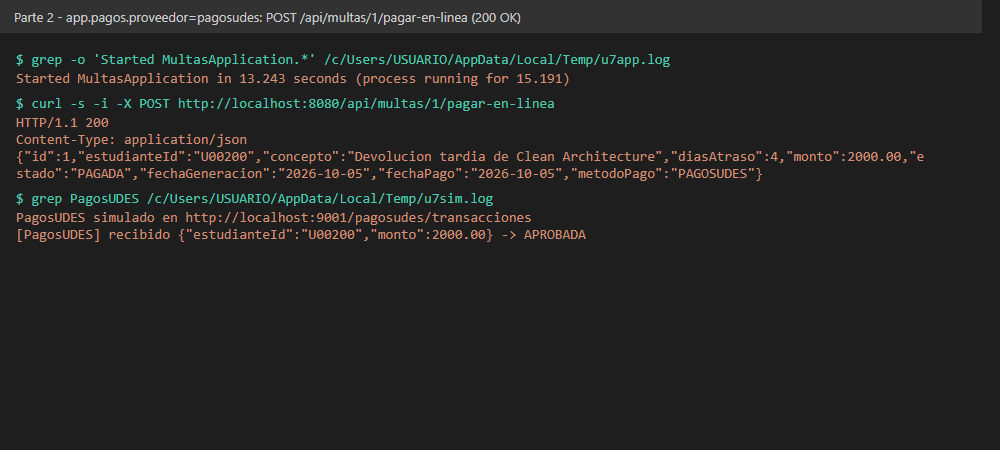

**PagosUDES rechaza — 402 Payment Required con el mensaje del proveedor**
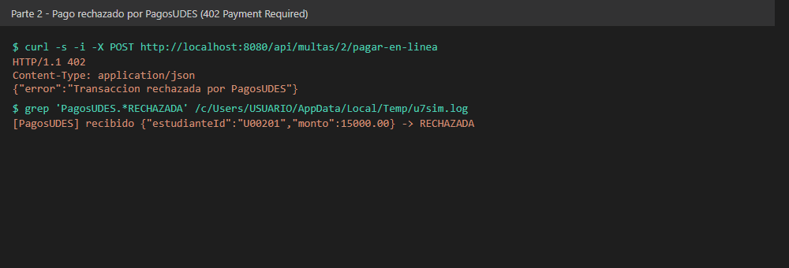

**Multa ya pagada, en línea o por ventanilla — 409 Conflict en ambos casos**
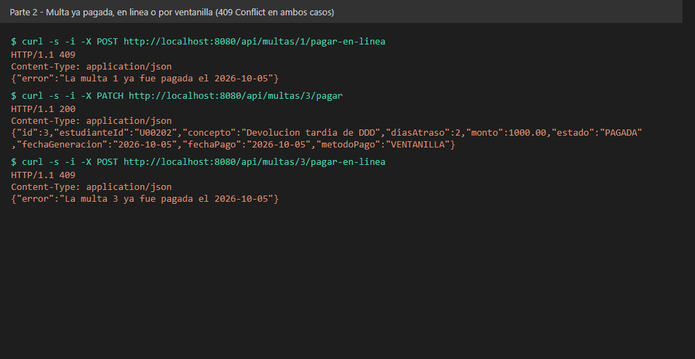

**Mismo jar con `--app.pagos.proveedor=wompi` — 200 OK, `metodoPago: WOMPI`.** El simulador recibe
`amountInCents: 300000` para una multa de $3.000. Después, pagarla por ventanilla da 409.
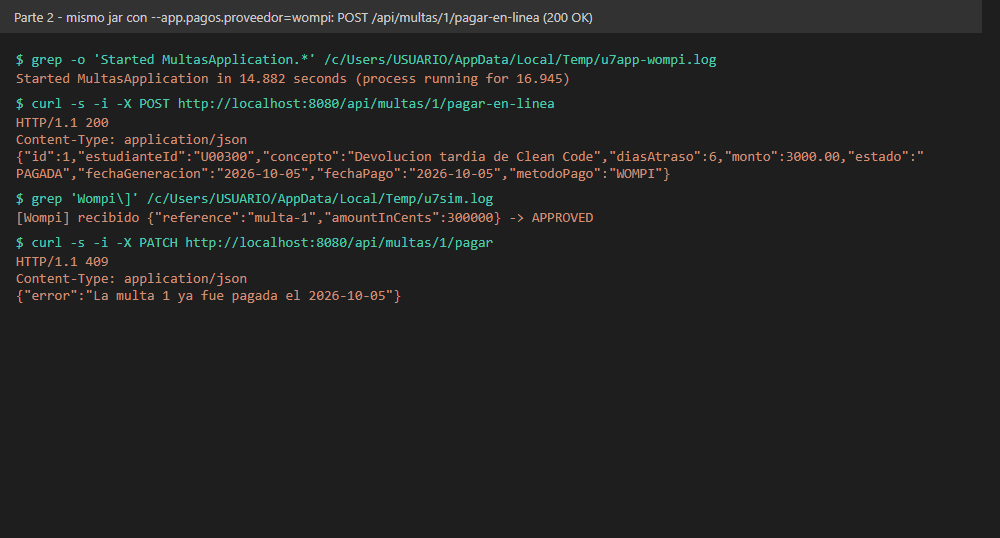

**Wompi rechaza (DECLINED) — 402 Payment Required**
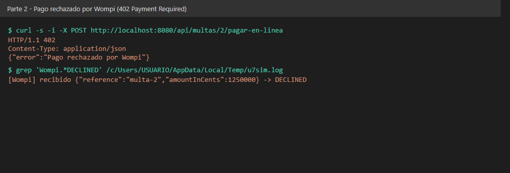

**Pasarela caída — 402 y la multa sigue PENDIENTE.** El adaptador captura la `RestClientException`
y devuelve un `ResultadoPago` fallido, así que el Service no tiene que saber de errores HTTP.
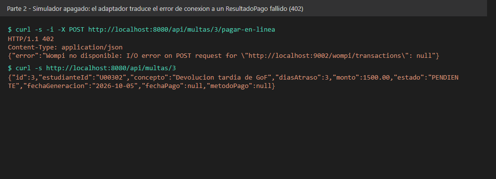

---

## Pruebas automáticas (24)

| Clase | Qué prueba |
|---|---|
| `MultaTest` | Monto por día, tope de $15.000 y doble pago, sobre la entidad sola |
| `MultaControllerTest` | Checkpoints de la Parte 1 con MockMvc (200, 201, 400, 404, 409) |
| `MultaServicePagoEnLineaTest` | `pagarConPasarela` con una pasarela falsa (una lambda): aprobado, rechazado, y que una multa pagada no llegue a la pasarela |
| `AdaptadoresPagoTest` | Cada adaptador contra un servidor HTTP simulado (`MockRestServiceServer`): formato que envía, centavos de Wompi, aprobado, rechazado y caída |
| `SeleccionPasarelaTest` | Con `pagosudes` o `wompi` solo existe el adaptador correspondiente |
| `PagoEnLineaControllerTest` | `/pagar-en-linea`: 200, 402, y 409 si ya se pagó por ventanilla o en línea |
| `DomainSinSpringTest` | Que `domain/` solo importe `java.*` |

## Cómo ejecutar
Requisitos: Java 17 o superior y Maven 3.8+.

```bash
cd multas-biblioteca-api
mvn clean package
mvn spring-boot:run
```

- API: http://localhost:8080/api/multas
- Consola H2: http://localhost:8080/h2-console (JDBC URL `jdbc:h2:mem:multas_biblioteca_db`, usuario `sa`, sin contraseña)

Para probar el pago en línea, en otra terminal levantar el simulador de pasarelas:

```bash
cd simulador-pasarelas
java SimuladorPasarelas.java
```

Y para usar Wompi en vez de PagosUDES:

```bash
mvn spring-boot:run -Dspring-boot.run.arguments=--app.pagos.proveedor=wompi
```

## Herramientas utilizadas
- Java 17, Spring Boot 3.5, Spring Data JPA, H2, Bean Validation, RestTemplate
- Apache Maven, curl, JUnit 5, Mockito, MockMvc, MockRestServiceServer, Git, GitHub

## Decisiones de diseño

### Punto de decisión 1 — Cálculo del monto: ¿entidad o Service?
`calcularMonto` vive en la entidad `Multa` como método estático. El criterio que usé fue: **si una
regla no necesita ningún colaborador externo (repositorio, otro service, configuración), es del
objeto de dominio; si necesita consultar algo, es del Service.** El monto solo depende de los días de
atraso, que ya llegan como parámetro, así que no hay razón para que pase por una capa de Spring.

Si la fórmula fuera un método privado de `MultaService`:
- `Multa` quedaría como un contenedor de getters y setters sin comportamiento (modelo anémico) y la
  regla "una multa nunca pasa de $15.000" no estaría donde se define qué es una multa.
- Cualquier otra parte que necesite el monto (por ejemplo, simular cuánto pagaría un estudiante si
  devuelve el libro hoy) tendría que duplicar la fórmula o inyectar el Service completo para algo que
  no necesita base de datos.
- Para probarla habría que levantar o simular el Service con su repositorio; hoy `MultaTest` la
  prueba con una línea de Java puro.

Con el mismo criterio, `marcarComoPagada` también está en la entidad: verificar que no esté pagada
ya solo depende del estado de la misma multa.

### Punto de decisión 2 — Conteo de multas pendientes: ¿consulta o filtrado en memoria?
La regla "máximo 3 pendientes" sí necesita datos que solo tiene la base de datos. La **decisión** de
negocio (¿se permite una multa más?) la toma `MultaService`, pero el **dato** lo calcula el motor de
BD con `countByEstudianteIdAndEstado`. Con `spring.jpa.show-sql=true` se ve en la consola la
consulta que genera Hibernate:

```sql
select count(m1_0.id) from multas m1_0 where m1_0.estudiante_id=? and m1_0.estado=?
```

La alternativa era `findByEstudianteId(...)` y filtrar con `stream().filter(PENDIENTE).count()`.
Funciona igual con 5 multas de prueba, pero trae a memoria **todo el historial** del estudiante
(pagadas incluidas) solo para obtener un número. Si un estudiante tuviera miles de multas, cada vez
que se genera una nueva se cargarían y convertirían en objetos miles de filas, así que el tiempo de
crear una multa crecería en proporción a su historial. Con el `COUNT` la BD devuelve un solo número
y, si hiciera falta, se podría acelerar con un índice sobre `(estudiante_id, estado)` sin cambiar
nada del Service.

### Punto de decisión 3 — Selección del adaptador activo
Elegí **`@ConditionalOnProperty`**: cada adaptador declara con qué valor de `app.pagos.proveedor`
se crea, así que al arrancar solo existe **un** bean de `PasarelaPagoPort` y `MultaService` lo pide
por constructor sin `@Qualifier` ni ningún `if`. `PagosUdesAdapter` tiene `matchIfMissing = true`
para que, si nadie configura la propiedad, la sede principal siga funcionando.

| | `@ConditionalOnProperty` (elegida) | `Map<String, PasarelaPagoPort>` en el Service |
|---|---|---|
| Cuándo se elige | Al arrancar | En cada petición |
| Cambiar de pasarela | Cambiar la propiedad y reiniciar | Sin reiniciar |
| Qué sabe `MultaService` | Nada: recibe "la" pasarela | Las claves (`"pagosudes"`, `"wompi"`) y cómo elegir entre ellas |
| Error de configuración | La app no arranca (falla rápido y visible) | Aparece en la primera petición con una clave que no existe |

El `Map` da más flexibilidad, pero el requisito real es **una pasarela fija por sede durante el
piloto**: nadie necesita cambiar de pasarela en caliente. Pagar esa flexibilidad metería en
`MultaService` las claves de configuración de cada proveedor, que es justo el conocimiento que el
puerto busca sacar de ahí. Si más adelante se pidiera que el estudiante escoja la pasarela al pagar,
ahí sí cambiaría al `Map` (o a un selector aparte), sin tocar los adaptadores.

### Punto de decisión 4 — Diseño del puerto y el tipo de resultado
Los dos adaptadores reciben y devuelven formatos que no se parecen en nada, pero ambos terminan
devolviendo el mismo `ResultadoPago(proveedor, exitoso, referenciaExterna, mensaje)`:

| Campo de `ResultadoPago` | PagosUDES | Wompi |
|---|---|---|
| `exitoso` | `estadoTransaccion == "APROBADA"` | `status == "APPROVED"` |
| `referenciaExterna` | `idTransaccion` | `reference` |
| monto enviado | pesos | centavos (× 100, lo hace el adaptador) |

Si `PasarelaPagoPort.procesar` devolviera el DTO de cada pasarela (o tuviera un método por
proveedor), `MultaService` tendría que preguntar "¿esto es de PagosUDES o de Wompi?" para saber si
el pago se aprobó, y agregar una tercera pasarela obligaría a modificar el Service además de crear
el adaptador. Es volver a la opción A por la puerta de atrás.

El nombre de los campos también importa. Si `ResultadoPago` tuviera un campo `idTransaccion` en vez
de `referenciaExterna`, el tipo "neutral" estaría copiando el vocabulario de PagosUDES: `WompiAdapter`
tendría que meter su `reference` (que en realidad es la referencia que nosotros enviamos,
`multa-<id>`) en un campo que dice ser un id de transacción, o inventar un valor. Esa incomodidad es
la señal de que el tipo de dominio no era neutral. `referenciaExterna` solo dice "lo que la pasarela
usa para identificar este pago", y eso aplica a cualquier proveedor.

Por la misma razón el puerto recibe `SolicitudPago` y no `Multa` (ver Parte 2): el contrato hacia
fuera solo lleva lo que cualquier pasarela necesita.

### Trade-off considerado — Parte 2
**Descarté A (if/switch en `MultaService`)** porque mete en el Service los dos clientes HTTP, los
DTOs y la conversión a centavos; cada pasarela nueva o retirada obliga a abrir y volver a probar el
Service, que es la clase con las reglas de negocio de la Parte 1. Lo único a su favor es que es lo
más rápido de escribir con dos pasarelas fijas, y el requisito dice explícitamente que no van a
quedarse fijas.

**B (Strategy en `service/`) fue la alternativa seria**, y honestamente resuelve el intercambio casi
igual de bien. A favor de B: no crea paquetes nuevos y cualquiera que conozca Spring lo entiende sin
hablar de puertos. En contra, para este caso: (1) la interfaz quedaría en `service/` junto a
implementaciones `@Service` que hablan HTTP, así que la capa de aplicación terminaría dependiendo de
RestTemplate por paquete; (2) nada en la estructura impide que la interfaz devuelva el DTO de una
pasarela, mientras que en C la regla "domain/ solo importa java.*" es visible y está probada
(`DomainSinSpringTest`). La diferencia entre B y C es más de dónde quedan los límites que de
cantidad de código.

**Lo que costó C:** 2 paquetes nuevos (`domain/`, `infrastructure/`), 7 clases (162 líneas), un tipo
extra (`SolicitudPago`) que hay que armar a partir de `Multa`, y explicar el vocabulario de puertos
y adaptadores a quien solo conoce capas. A cambio, la integración en lo que ya existía fue pequeña:
35 líneas entre `MultaService` (+24), `MultaController` (+5) y `GlobalExceptionHandler` (+7), sin
cambiar ningún método de la Parte 1. También aparecieron dos inconsistencias que hay que asumir:
ahora hay dos paquetes de "dominio" (`model/` de la Parte 1 y `domain/` del pago), y
`pagarConPasarela` hace la llamada HTTP dentro de la transacción de `MultaService`, así que una
pasarela lenta mantiene abierta una conexión a la BD (los timeouts de `RestTemplateConfig` lo
limitan, pero no lo resuelven).

**¿Revertiría si queda una sola pasarela?** No del todo. Si el piloto termina y solo queda PagosUDES,
quitaría `WompiAdapter` y el `@ConditionalOnProperty`, pero dejaría el puerto: sigue aislando el
formato HTTP de PagosUDES del Service y permite probar `MultaService` con una lambda. Solo volvería
a capas puras (llamar a PagosUDES desde una clase de `service/`) si el equipo no se sintiera cómodo
con los dos paquetes nuevos, porque con una sola pasarela el beneficio de C baja bastante y el costo
de entenderlo sigue igual.

## Conclusiones
La regla que más me sirvió en la Parte 1 fue preguntar "¿esta regla necesita a alguien más?": el
monto no necesita a nadie y quedó en la entidad, el tope de pendientes necesita la BD y quedó en el
Service, apoyado en un `COUNT` en vez de traer todo a memoria. En la Parte 2 lo difícil no fue
implementar el puerto sino decidir si valía la pena, porque la opción B resolvía el intercambio casi
igual y con menos ceremonia; lo que inclinó la balanza fue que los dos contratos HTTP son realmente
distintos y que el número de pasarelas va a cambiar, que es exactamente lo que el puerto aísla.
También aprendí que el tipo del puerto se diseña pensando en todas las pasarelas, no en la primera:
llamar `idTransaccion` al campo habría amarrado el dominio a PagosUDES, y pasar la entidad `Multa`
lo habría amarrado a JPA. Y que aplicar hexagonal "solo donde duele" es una decisión válida: el
CRUD de multas no ganaba nada con puertos.
